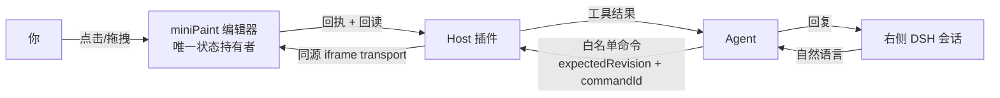

# DSH 图片编辑器 · 人机协作

[](./miniPaint/MIT-LICENSE.txt)
[](https://nodejs.org)
[](https://github.com/deepseek-ai/deepseek-harness)
[](#状态)

**在 DSH 里，人和 Agent 编辑同一张画布。** 左侧是真正的 miniPaint 中文编辑器，右侧是真正的 DSH 会话。
你说一句「把这行字改成红色」，Agent 就通过受控命令改你正在看的这份工程——你能看见、能撤销，它也能回读确认。

不是把编辑器塞进聊天窗口，也不是给 Agent 开个后门直改文件：**只有一份原生工程状态，人机共用一条受控命令通道。**

## 为什么不是「截个图让 AI 改」

图片编辑最难的不是生图，是**改完之后人和 AI 谁的版本算数**。三条硬约束：

| 约束 | 做法 | 后果 |
| --- | --- | --- |
| 版本一致 | 写命令带 `expectedRevision`，写入后立即回读校验 | 旧版本写入被拒（`REVISION_CONFLICT`），不会静默覆盖你刚做的修改 |
| 防重复执行 | `commandId` 幂等，结果未知记 `unknown` 并禁止重放 | 超时也不会把同一条命令执行两遍 |
| 撤销可信 | 定向撤销校验 `commandId + afterDigest + revision + 历史栈顶` | 之后有人改过就返回 `HISTORY_CONFLICT`，不会撤错别人那一步 |

## 能力状态

隔离 DSH 实例上实测通过（真实工具调用 + 真实浏览器）：

- 首次绑定：宿主原生审批 `allowed-once`，审批前后页面/工程/快照必须一致，客户端自报 sessionId 不参与授权
- 写入与回读：`R0 → apply → R1`，`lastCommandId / appliedRevision / afterDigest` 三者一致
- 定向撤销：`R1 → R2`，digest 精确回到写入前基线，重做正常
- 冲突保护：旧凭据复用 `HISTORY_CONFLICT`，空历史 `HISTORY_EMPTY`，过期 revision 被拒且无副作用
- 切页保活：图片 ↔ 视频 ↔ 原生会话往返，工程、会话与撤销历史保留

待验收：PNG/JPEG 实际下载并打开、工程保存重开、极简布局。

## 架构



- **状态只存在编辑器里**：Host 不存第二份工程，Agent 也没有任意 JS 通道。
- Host 负责白名单命令、`expectedRevision`、`commandId` 防重、写后审计与会话↔工程绑定。
- 绑定走宿主原生审批：用户本人点「允许一次」，Host 复验页面与工程快照未变才登记。

## 快速开始

```bash
cd miniPaint && npm install && npm run build   # 构建编辑器
node host/pack-image.mjs                       # 生成插件内图片页产物
```

装进 DSH（隔离 profile，勿直接覆盖生产）后，首次调用 `media_image_read_state` 带 `bind:true` 触发绑定审批；批准后省略 `bind` 即可读写。

## 目录

| 路径 | 内容 |
| --- | --- |
| `miniPaint/` | miniPaint 底座：中文界面、Apple 主题、原生历史桥、PNG/JPEG 导出 |
| `host/` | 图片宿主页、同源 iframe transport、图片页打包脚本 |
| `contracts/` | `editor-bridge.v1` 命令/状态契约、DSH 会话接口核查记录 |

## 状态

原型阶段，隔离环境验证中，**未上生产**。能力矩阵以外的项目一律视为未验证。

## 许可与致谢

- 编辑器底座：[miniPaint](https://github.com/viliusle/miniPaint)，MIT
- 宿主与协作层：本仓库原创

视频侧见 [dsh-video-studio](https://github.com/Brian-dai694/dsh-video-studio)。

[](https://github.com/deepseek-ai/deepseek-harness)
