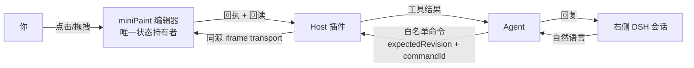

# DSH 图片编辑器 · 人机协作

[](./miniPaint/MIT-LICENSE.txt)
[](https://nodejs.org)
[](https://github.com/deepseek-ai/deepseek-harness)
[](./plugin/dsh-media-image/package.json)
[](#状态)

**当前版本 0.14.0**：版本号唯一来源是 `plugin/dsh-media-image/package.json`；编辑器界面（完整模式右下角、极简模式顶栏）显示同一个值，改版本后在插件目录跑 `npm run sync-version` 即可同步页面常量与这里的徽标。

**在 DSH 里，人和 Agent 编辑同一张画布。** 左侧是真正的 miniPaint 中文编辑器，右侧是真正的 DSH 会话。
你说一句「把这行字改成红色」，Agent 就通过受控命令改你正在看的这份工程——你能看见、能撤销，它也能回读确认。

不是把编辑器塞进聊天窗口，也不是给 Agent 开个后门直改文件：**只有一份原生工程状态，人机共用一条受控命令通道。**

## 对话框静态夹具（NON-RUNTIME，不是验收）

`docs/fixtures/dialog-fixture.html` 是一个可重复运行的**静态夹具**：它喂样例「会话事件」给真实的
`makeTranscript → buildDialogPlan → Conversation`，因此渲染路径与线上一致，只差数据来源。
它**没有连接任何 DSH 会话**，不代表运行时行为，**不计入验收通过**。

事件来源写在 `docs/fixtures/real-events.json` 的每条 `fixtureOrigin` 里：**14 条是 FDE 在 0.2.1 上抓的原文**
（`probe`，含 `REVISION_CONFLICT` 那对 39/40），**2 条是 `synthetic`**，仅用于证明「只有显式
`meta.status='unknown'` 才显示结果未知」。来源守卫测试会逐字段比对 `probe` 条目与抓包原文。

覆盖：用户消息、助手 Markdown（标题/列表/代码块/行内代码/引用/链接/内联图片）、助手流式增量、
工具卡片四态（`applied` / `rejected` / `unknown` / `pending`）、审批四态、会话错误、裸 JSON 兜底
（「这一步已执行（无法解析摘要）」+ 仅剪贴板诊断）、三种空状态（未绑定 / 已绑定无消息 / 解析失败）。

离线复现步骤（仓库根目录执行）：

```bash
# 1) 只装开发依赖：react / react-dom 固定 18.3.1（与宿主同版本，package-lock.json 已提交）
cd plugin/dsh-media-image && npm ci && cd ../..

# 2) 在仓库根目录起任意静态服务（示例用 Python 自带模块，不需要联网）
python -m http.server 8819

# 3) 打开
#    http://127.0.0.1:8819/docs/fixtures/dialog-fixture.html
```

`react-dom` 只在 `devDependencies` 里，`npm pack` 产物不含 `docs/`、`node_modules/` 或任何夹具文件
（`npm pack --dry-run --json` 可自证）。截图见
[top](docs/screenshots/image-chat-fixture-top.png) · [tools](docs/screenshots/image-chat-fixture-tools.png) ·
[bottom](docs/screenshots/image-chat-fixture-bottom.png) · [empty](docs/screenshots/image-chat-fixture-empty.png)，
全部标注 **non-runtime**。

## 为什么不是「截个图让 AI 改」

图片编辑最难的不是生图，是**改完之后人和 AI 谁的版本算数**。三条硬约束：

| 约束 | 做法 | 后果 |
| --- | --- | --- |
| 版本一致 | 写命令带 `expectedRevision`，写入后立即回读校验 | 旧版本写入被拒（`REVISION_CONFLICT`），不会静默覆盖你刚做的修改 |
| 防重复执行 | `commandId` 幂等，结果未知记 `unknown` 并禁止重放 | 超时也不会把同一条命令执行两遍 |
| 撤销可信 | 定向撤销校验 `commandId + afterDigest + revision + 历史栈顶` | 之后有人改过就返回 `HISTORY_CONFLICT`，不会撤错别人那一步 |

## 能力状态

隔离 DSH 实例上实测通过（真实工具调用 + 真实浏览器）：

- 首次绑定：宿主原生审批 `allowed-once`，审批前后页面/工程/快照必须一致，客户端自报 sessionId 不参与授权
- 写入与回读：`R0 → apply → R1`，`lastCommandId / appliedRevision / afterDigest` 三者一致
- 定向撤销：`R1 → R2`，digest 精确回到写入前基线，重做正常
- 冲突保护：旧凭据复用 `HISTORY_CONFLICT`，空历史 `HISTORY_EMPTY`，过期 revision 被拒且无副作用
- 切页保活：图片 ↔ 视频 ↔ 原生会话往返，工程、会话与撤销历史保留

待验收：PNG/JPEG 实际下载并打开、工程保存重开、极简布局。

## 架构



- **状态只存在编辑器里**：Host 不存第二份工程，Agent 也没有任意 JS 通道。
- Host 负责白名单命令、`expectedRevision`、`commandId` 防重、写后审计与会话↔工程绑定。
- 绑定走宿主原生审批：用户本人点「允许一次」，Host 复验页面与工程快照未变才登记。

## 插件包

`plugin/dsh-media-image/` 是可独立安装的 DSH 插件包，只注册图片这一次工具集：

| 工具 | 作用 |
| --- | --- |
| `media_image_read_state` | 读工程状态；首次带 `bind:true` 触发原生审批绑定 |
| `media_image_apply_command` | 提交白名单命令（`layer.*` / `canvas.*` / `history.*`），带 `expectedRevision` 与 `commandId` |
| `media_image_get_command_result` | 结果未知时回查，避免盲目重放 |
| `media_image_export_start` / `media_image_export_status` | PNG / JPEG 导出与状态 |

路由前缀 `/media-image`，与视频插件包（`/media-video`）互不依赖、可同时安装。
## 下载安装

预打包插件（可直接装进 DSH profile）：[v0.4.2 · dsh-media-image-0.4.2.tgz](https://github.com/Brian-dai694/dsh-image-studio/releases/download/v0.4.2/dsh-media-image-0.4.2.tgz)

```powershell
dsh plugin --profile <你的profile> add <下载路径>\dsh-media-image-0.4.2.tgz
```

包里已含 PSD 导入所需的 `public/image/dist/860.bundle.js`（ag-psd 懒加载 chunk），无需另外构建。

0.4.2 的 tgz SHA-256：`3438cc91f057dabddf7c8deb8cb46b38637f6f66286055df541a2b0a09ddf2e7`（与 Release 资产 digest 一致，可核对）。
## 快速开始

```bash
cd miniPaint && npm install && npm run build   # 构建编辑器
node host/pack-image.mjs                       # 生成插件内图片页产物
```

装进 DSH（隔离 profile，勿直接覆盖生产）后，首次调用 `media_image_read_state` 带 `bind:true` 触发绑定审批；批准后省略 `bind` 即可读写。

## 目录

| 路径 | 内容 |
| --- | --- |
| `miniPaint/` | miniPaint 底座：中文界面、Apple 主题、原生历史桥、PNG/JPEG 导出 |
| `plugin/dsh-media-image/` | 独立插件包：Host 工具、命令门控、relay 与图片页产物 |
| `host/` | 图片宿主页、同源 iframe transport、图片页打包脚本 |
| `contracts/` | `editor-bridge.v1` 命令/状态契约、DSH 会话接口核查记录 |

## 状态

原型阶段，隔离环境验证中，**未上生产**。能力矩阵以外的项目一律视为未验证。

## 许可与致谢

- 编辑器底座：[miniPaint](https://github.com/viliusle/miniPaint)，MIT
- 宿主与协作层：本仓库原创

视频侧见 [dsh-video-studio](https://github.com/Brian-dai694/dsh-video-studio)。

[](https://github.com/deepseek-ai/deepseek-harness)


